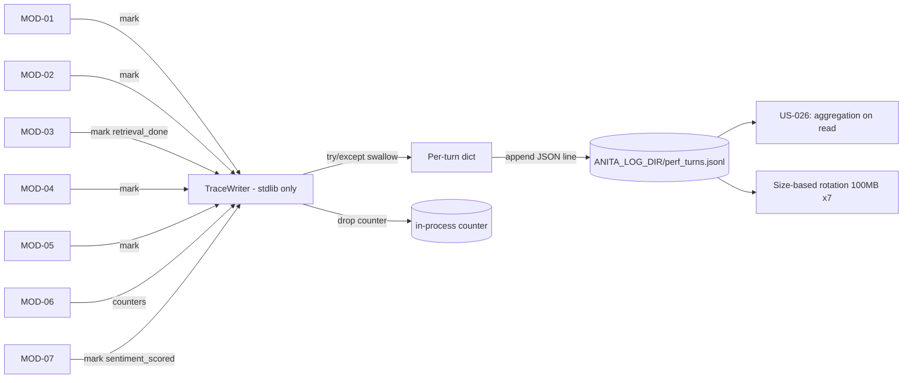

> **Lens:** PO / TPO (technical ACs) / Architect (HLD, LLD) · **Engagement:** Brownfield

# US-025 — Dependency-free per-turn trace emission [Lens: PO]

- **Story:** As an **ops admin**, I want **every conversation turn to leave a trace of what happened, how long each stage took and whether retrieval found anything**, so that **I can answer "why was that answer slow or wrong?" without reproducing the call**.
- **Business value:** `BRD-21`. It is also the only instrument that can resolve `DG-01` — nobody knows the real traffic and concurrency, so the inherited 2-call ceiling and VRAM budget stay guesses until this data exists.
- **Priority:** **Must** — TPO ordering note: built **early**, before the modules that emit to it, because nothing else's change is adoptable until it can be measured (`05-modularization.md` Decision Record). It is deliberately first in MOD-08.

## Acceptance Criteria [Lens: PO]

```gherkin
Scenario: A web-chat turn emits a trace
  Given a completed web-chat turn that used retrieval
  When the turn finishes
  Then one trace record exists for that turn
  And it names the channel, the turn number and which stages ran
  And it carries the retrieval hit/miss and the answer latency
  And it carries the sentiment category but not the transcript

Scenario: Tracing fails
  Given the trace writer has been made to raise on every call
  When a buyer completes a full conversation on voice
  Then the buyer hears a completely normal conversation
  And the conversation is stored, scored and handled exactly as before
  And the trace failures are counted and alerted

Scenario: A stage did not run
  Given a turn with no retrieval stage (a deterministic price answer)
  When its trace is written
  Then the retrieval stage is absent from the record
  And it is not reported as zero milliseconds
  And the record still lists the stages that did run

Scenario: No buyer PII in a trace
  Given a turn in which the buyer said their name, phone number and email
  When the trace is written
  Then the trace contains no name, no phone number, no email and no transcript text
  And a grep of the trace file for those values returns nothing
```

Technical acceptance criteria [Lens: TPO]:

- **TAC-1:** The trace writer imports **stdlib only** — no `app.*` import — and every public method swallows its own exceptions. This is enforced by an import test that asserts the module's dependency set.
- **TAC-2:** Emission adds ≤ 2 ms p95 to a turn and performs **zero** blocking I/O on the turn path.
- **TAC-3:** A stage that did not run is absent from the record; `stages_seen` is always present so a reader can distinguish a short turn from a broken one.
- **TAC-4:** Deletion test: with the whole `anita.observability` package import-blocked, every channel still completes a conversation end to end.
- **TAC-5:** The trace log rotates at 100 MB with 7 retained files, and the rotation never drops a turn silently — dropped writes are counted.

## HLD — Architecture Slice [Lens: Architect]



- **Components touched:**
  - `MOD-08 TraceWriter` — new: context-local stage marks, one JSON line per turn, stdlib only.
  - `MOD-01…MOD-07` — existing: new `mark()` call sites at each stage boundary (best-effort, no return contract).
  - `MOD-09` — existing: supplies `ANITA_LOG_DIR`, already proven isolated by the isolation guard.
  - `MOD-08 Rotation` — new: size-based rotation inside the writer.
- **Interaction summary:**
  1. A turn begins; the writer creates a context-local record keyed by `turn_id`.
  2. Each module calls `mark(stage)` at its boundary; marks are O(1) dict writes.
  3. At turn end, the writer computes durations between consecutive *present* marks and appends one JSON line.
  4. **Failure path:** any exception inside the writer is swallowed, the turn continues, and an in-process drop counter is incremented; the counter is exposed by US-026 and alerted above 1 %.
  5. If the log directory is unwritable, the writer disables itself for the process rather than retrying on every turn.

## LLD — Implementation Detail [Lens: Architect]

- **Classes / functions / APIs:**

```python
# app/anita/observability/trace.py  — stdlib only (TAC-1)
Stage = Literal["turn_received","classified","retrieval_done","sql_lookup_done",
                "llm_sent","llm_first_token","llm_done","answer_composed",
                "channel_send_start","channel_send_done","sentiment_scored","outcome"]

ENABLED: bool = os.environ.get("ANITA_TRACE", "1") == "1"
LOG_PATH: Path = Path(os.environ.get("ANITA_LOG_DIR", "logs/anita")) / "perf_turns.jsonl"
ROTATE_BYTES = 100 * 1024 * 1024
KEEP_FILES = 7

def begin(turn_id: str, *, conversation_id: str, channel: str) -> None: ...
def mark(stage: Stage, **counters: int | float | bool) -> None: ...
def emit(*, outcome: str, admission_refused: bool = False) -> None: ...
def note(key: str, value: int | float | bool) -> None: ...
def dropped() -> int: ...                      # in-process drop counter for US-026
def disable() -> None: ...                     # sticky, after a write failure

def _rotate_if_needed() -> None: ...
def _compute_durations(marks: dict[str, float]) -> dict[str, int]: ...
```

- **Data schema changes:** none in Postgres. The trace record is an append-only JSONL line; no DDL, deliberately, so that MOD-08 can never take a schema lock on the conversation path.

```json
{"turn_id":"t_8f21","conversation_id":"c_44ab","channel":"voice","turn_no":2,
 "stages_seen":["turn_received","classified","retrieval_done","llm_sent","llm_first_token","llm_done","answer_composed","channel_send_start","channel_send_done","sentiment_scored","outcome"],
 "durations_ms":{"classify":12,"retrieval":36,"llm_ttft":310,"llm_total":980,"compose":8,"send":41},
 "retrieval":{"hits":3,"top_score":0.83,"not_relevant":false,"sparse_only":false},
 "sentiment":{"category":"Warm","mode":"llm","s_lead":0.42},
 "outcome":"answered","admission_refused":false,"dropped_marks":0,"version":"anita-1"}
```

- **Edge cases** (each with the decided behaviour):
  1. **A stage is marked twice** → the second mark is ignored with `dropped_marks += 1`; the first timestamp is authoritative.
  2. **`emit()` is never called for a turn (crash mid-answer)** → the next turn for that conversation starts a fresh record; the orphan is not written, and `turn_received` without `outcome` upstream is how the drop is detected (a session-level counter).
  3. **Concurrent turns in one process** → records are held in a `contextvars.ContextVar`, so async turns cannot interleave marks.
  4. **Log directory missing** → created once; if creation fails, the writer disables itself sticky and increments `dropped` per turn rather than retrying I/O.
  5. **Disk full mid-append** → the write raises, is swallowed, the writer disables itself, and the drop counter spikes (alert threshold 1 %).
  6. **Rotation during a turn with concurrent writers** → rotation happens under an OS-level file lock with `os.replace`; an in-flight append writes to the old handle harmlessly.
  7. **`ANITA_TRACE=0`** → every public function is a no-op; `mark`/`emit` return immediately and add no measurable cost.
  8. **A counter contains a buyer-supplied string** → `note()` accepts only `int | float | bool`; strings are refused by the type signature and by a runtime assert, so PII cannot enter through the counter path (TAC-4).
  9. **Clock jumps backwards mid-turn** → a negative duration is clamped to `0` and the record is flagged `clock_skew: true`; a reader is never shown a negative latency.

- **Error handling:**
  - Every public function wraps its body in `try/except Exception` and returns `None`; the trace writer has **no** error path that reaches a caller (TAC-1).
  - `TraceDisabled` — not an exception; an internal sticky flag with a one-time log line.
  - Drop counter — exposed via `dropped()`; US-026 alerts above 1 % of turns over 15 min.

- **Test scenarios** (floor = the `UC-12` / `UC-13` trace-related rows):
  - *Unit* — happy path: begin → mark 5 stages → emit produces one line with all 5 in `stages_seen`.
  - *Unit* — absent-not-zero: a turn with no `retrieval_done` → `durations_ms` has no `retrieval` key (TAC-3).
  - *Unit* — duplicate mark: two `classified` marks → one duration, `dropped_marks == 1`.
  - *Unit* — import isolation: `import app.anita.observability.trace` with `sys.modules` poisoning every `app.*` module still succeeds (TAC-1).
  - *Unit* — PII refusal: `note("buyer_name", "Priya")` is rejected; `note("hits", 3)` is accepted (TAC-4).
  - *Unit* — clock skew: a mark sequence with a reversed clock produces `0`, not a negative value.
  - *Integration* — unrelated dependency failure: force the writer to raise on every call → a full conversation completes on all four channels (TAC-4).
  - *Integration* — missing data: a fresh instance with no traces → `dropped() == 0`, the log file is created empty, no error.
  - *Integration* — rotation: write past 100 MB in a test directory → 7 files retained, no line lost.
  - *Integration* — concurrency: 50 concurrent async turns → 50 well-formed lines, no interleaved fields (contextvars isolation).
  - *E2E* — a voice call whose LLM stage is slow → the trace shows `llm_ttft` and `llm_total` and the stage budget breach is visible to the console.
  - *Load* — 500 turns with tracing on vs off → p95 delta ≤ 2 ms per turn (TAC-2).

## Traceability
- Parent module: `MOD-08`
- Use cases: `UC-12`, `UC-13` · technical requirement: `TRD-36`
- Business requirement: `BRD-21`
- Data gap / state machine: `DG-01` (basic instrumentation is what later resolves the unknown load model), `DG-11` (no PII in traces)
- Reconciliation: `REC-15` (`reuse` — `app/perf_trace.py` extended to the ANITA stage set, dependency-free property preserved)
- Data asset: `DAT-14` (perf traces)

## Definition of Done
- [ ] All ACs pass (AC-1 … AC-4, TAC-1 … TAC-5)
- [ ] Tests from the LLD test scenarios pass, including the import-isolation test and the PII-refusal assertion
- [ ] Load test passed: ≤ 2 ms p95 added per turn (TAC-2)
- [ ] Deletion check performed: `anita.observability` import-blocked, all four channels complete conversations
- [ ] No schema migration (by design — traces are file-based)
- [ ] Module docs updated if the stage set changed
