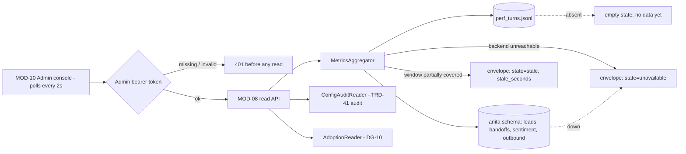

> **Lens:** PO / TPO (technical ACs) / Architect (HLD, LLD) · **Engagement:** Brownfield

# US-026 — Admin console read API: health, conversation review, and honest absence [Lens: PO]

- **Story:** As an **ops admin**, I want **one authenticated surface that shows this instance's channel health, live conversations and a full conversation drill-down — and says "unavailable" rather than showing a zero when a backend is down**, so that **I can diagnose without being misled, and I never mistake a broken metric for a quiet one**.
- **Business value:** `BRD-21`. The "unavailable, never zero" rule is the difference between an operator noticing an outage and an operator reading a healthy-looking chart while every channel is silent. It also carries `DG-10`'s adoption proxy and `DG-09`'s config audit to the person who can act on them.
- **Priority:** **Must** — TPO ordering note: depends on US-025 (traces must exist to read) and on the admin auth decision (CV-03: admin surfaces are authenticated, buyer surfaces stay open).

## Acceptance Criteria [Lens: PO]

```gherkin
Scenario: Operator checks channel health
  Given the instance is running with traffic on web chat and WhatsApp
  When the operator opens the console
  Then each channel shows its status, last inbound time and error count
  And no channel from the university product appears

Scenario: A backend is down
  Given the metrics backend is stopped
  When the operator loads the metrics panel
  Then the affected panels read "unavailable" with the reason
  And no panel reads zero
  And the reason is visible without opening a log file

Scenario: Operator drills into a flagged conversation
  Given a conversation that escalated with negative sentiment
  When the operator opens it from the sentiment alert
  Then the full turn trail is shown, including the triggering turn
  And retrieval hit/miss, latency and sentiment are shown per turn
  And the handoff and lead record are linked

Scenario: Early turns have no sentiment
  Given a conversation whose first two turns predate scoring
  When the operator opens it
  Then those turns are shown with sentiment absent, not zero
  And the rest of the trail renders normally

Scenario: Unauthenticated access
  Given no admin token
  When any console endpoint is called
  Then the request is rejected before any data is read

Scenario: Config audit result is visible
  Given the config audit found a key written but never read
  When the operator opens the configuration panel
  Then the key is named and marked as blocking the boot
  And the values of secret keys are never displayed
```

Technical acceptance criteria [Lens: TPO]:

- **TAC-1:** Every read returns the three-state envelope `{value, state: ok|unavailable|stale, source, window, as_of, stale_seconds}`; no endpoint returns a bare number and no endpoint zero-fills a missing window.
- **TAC-2:** Admin endpoints require a bearer token; a request without one is rejected before any store is touched (auth dependency runs first).
- **TAC-3:** Console read API p95 ≤ 300 ms, p99 ≤ 1 s over a 24-hour window at the assumed volume; a large transcript is paged at 200 turns with a cursor.
- **TAC-4:** The API reads only ANITA stores and paths; a test asserts that no query touches a non-`anita` schema and no file outside `ANITA_LOG_DIR` is opened.
- **TAC-5:** Every endpoint is read-only — a `GET` never mutates state; concurrent operators cannot affect each other.

## HLD — Architecture Slice [Lens: Architect]



- **Components touched:**
  - `MOD-08 MetricsAggregator` — new: reads traces + `anita` tables, produces envelopes.
  - `MOD-08 Admin API router` — new: the endpoint set (`TRD-37`), behind an auth dependency.
  - `MOD-08 ConfigAuditReader` — new: serves the `TRD-41` audit result, masked.
  - `MOD-08 AdoptionReader` — new: sentiment trend and category distribution (`DG-10`).
  - `MOD-09` — existing: supplies the admin token as a secret (`TRD-44`) and the audit computation.
  - `MOD-10` — existing: renders the panels and polls; the console UI change belongs to MOD-10's stories.
- **Interaction summary:**
  1. The console polls an endpoint with the admin bearer token.
  2. The auth dependency validates the token before any store access.
  3. The aggregator reads the trace log and/or `anita` tables for the requested window.
  4. Each metric is returned as an envelope; a failed backend read becomes `state: "unavailable"` with a reason, a partially covered window becomes `stale`.
  5. **Failure path:** if the trace log is absent (fresh instance) the endpoint returns an **empty state**, explicitly distinct from `unavailable` and from zero; if Postgres is down, the DB-backed panels are `unavailable` while trace-backed panels keep serving.

## LLD — Implementation Detail [Lens: Architect]

- **Classes / functions / APIs:**

```python
# app/anita/observability/envelope.py
@dataclass(frozen=True)
class MetricEnvelope:
    value: float | int | dict | list | None
    state: Literal["ok", "unavailable", "stale"]
    source: str; window: str; as_of: datetime; stale_seconds: int | None = None
    reason: str = ""                                   # populated when state != "ok"

def ok(value, *, source, window) -> MetricEnvelope: ...
def unavailable(*, source, reason) -> MetricEnvelope: ...     # value=None, NEVER 0
def stale(value, *, source, window, stale_seconds, reason) -> MetricEnvelope: ...

# app/anita/observability/aggregate.py
class MetricsAggregator:
    def channels(self) -> dict[str, MetricEnvelope]: ...
    def conversations(self, *, since: datetime, channel: str | None, limit: int, cursor: str | None): ...
    def conversation(self, conversation_id: str, *, page: int = 0, page_size: int = 200): ...
    def metrics(self, *, window: str) -> dict[str, MetricEnvelope]: ...
    def adoption(self, *, window: str) -> dict[str, MetricEnvelope]: ...
    def config_audit(self) -> dict: ...
    def trace_drops(self, *, window: str) -> MetricEnvelope: ...

# app/anita/observability/api.py
router = APIRouter(prefix="/api/anita/admin", dependencies=[Depends(require_admin)])

def require_admin(authorization: str = Header(...)) -> None: ...   # runs before any read (TAC-2)

@router.get("/channels")            # -> {channel: MetricEnvelope}
@router.get("/conversations")       # -> paged list
@router.get("/conversations/{cid}") # -> turn trail + handoffs + lead ref
@router.get("/metrics")             # -> {metric: MetricEnvelope} for window=1h|24h|7d
@router.get("/adoption")            # -> sentiment trend, category distribution
@router.get("/config-audit")        # -> {key: {state, value_source, effective_masked}} + inert list
```

- **Data schema changes:** none — this story is a read layer over tables owned by other stories plus the JSONL trace file. The only persisted artefact is an optional `anita.console_access_log` (who read what, when), which is written best-effort and never blocks a read:

```sql
CREATE TABLE IF NOT EXISTS anita.console_access_log (
    id         BIGSERIAL PRIMARY KEY,
    actor      VARCHAR(64) NOT NULL,      -- token id/label, never the token value
    endpoint   VARCHAR(128) NOT NULL,
    params     JSONB NOT NULL DEFAULT '{}',   -- no PII: ids and windows only
    at         TIMESTAMPTZ NOT NULL DEFAULT NOW()
);
```

- **Edge cases** (each with the decided behaviour):
  1. **No traces yet (fresh instance)** → `state: "ok"` with an explicit `empty: true` marker on the panel payload; the console shows "no data yet" — never `unavailable`, never zero (`UC-12` missing-data row).
  2. **Trace log absent but the instance has conversations** → `unavailable` with `reason: "trace log missing"`, because that is a fault, not an empty state.
  3. **Metrics backend down** → `unavailable` with the backend name (`UC-12` E1).
  4. **Some channels reporting, others not** → per-channel envelopes; the console shows a mix rather than one global state (`UC-12` partial-data row).
  5. **Unknown channel id** → `404` with the valid ids listed (`UC-12` invalid-input row).
  6. **Unknown conversation id** → `404` with a specific error, never an empty object (`UC-13` invalid-input row).
  7. **Transcript empty because a voice call failed early** → shown as empty with the call outcome; distinct from "expired" (`UC-13` missing-data row).
  8. **Transcript retention expired** → shown as `expired`, never as empty (`UC-13` E1).
  9. **Sentiment missing for early turns** → partial trail; per-turn sentiment is simply absent (`UC-13` partial-data row).
  10. **Slow backend (aggregation > 1 s)** → the endpoint returns `stale` with the last successful `as_of` and `stale_seconds`; the console labels it (`UC-12` timeout row).
  11. **Two operators polling at once** → read-only, idempotent, no locking (`UC-12`/`UC-13` concurrent rows).
  12. **A drill-down is interrupted** → no mutation occurs by construction (TAC-5).
  13. **Export of a conversation is interrupted** → the partial file is discarded; the API never streams a half-document as complete (`UC-13` partial-completion row).
  14. **Admin token expired** → `401` before any read; the console shows a re-auth prompt, not a blank panel.

- **Error handling:**
  - `Unauthorized` — raised by `require_admin` before any store access (TAC-2).
  - `NotFoundError` — resource-specific 404 with the offending id echoed.
  - `BackendUnreadable` — caught by the aggregator and converted to an `unavailable` envelope; it never becomes a 500, because a 500 would hide the reason.
  - `AggregationTimeout` — converted to a `stale` envelope with the last good value; the endpoint never hangs the console's 2 s poll.
  - `AccessLogWriteFailed` — swallowed; audit logging is best-effort and never blocks a read.

- **Test scenarios** (floor = every `✓` row of the `UC-12` and `UC-13` Scenario Coverage tables):
  - *Unit* — happy path: `channels()` returns one envelope per configured ANITA channel with `state='ok'`.
  - *Unit* — envelope contract: `unavailable()` yields `value is None` and `state='unavailable'` — asserted never to be `0` (TAC-1).
  - *Unit* — empty vs unavailable: a fresh instance returns `empty: true`, not `unavailable`; a deleted trace log returns `unavailable`.
  - *Unit* — unknown id: `conversation("nope")` raises `NotFoundError` with the id.
  - *Unit* — invalid input: `window="13h"` → `422` naming the allowed windows.
  - *Integration* — alternate A1: opening a conversation from a sentiment alert lands on the triggering turn.
  - *Integration* — unauthorized user: every endpoint without a token → 401 and a spy store asserts zero reads (TAC-2).
  - *Integration* — missing data: conversation with an empty transcript → empty with outcome, not an error.
  - *Integration* — partial data: some channels reporting → per-channel envelope states differ.
  - *Integration* — duplicate request: two identical reads → identical payloads, no side effects (TAC-5).
  - *Integration* — timeout: aggregation forced slow → `stale` with `stale_seconds` set and the console able to label it.
  - *Integration* — dependency failure: Postgres stopped → DB-backed panels `unavailable`, trace-backed panels still `ok`.
  - *Integration* — retry / recovery: backend returns → next poll is `ok` with fresh `as_of` (`UC-12` recovery row).
  - *Integration* — concurrent operation: 5 parallel operator sessions → no lock contention, no state change.
  - *Integration* — cancellation: operator disconnects mid-drill-down → no mutation, no orphaned lock.
  - *Integration* — partial completion: export interrupted → partial output discarded, API reports the export as failed.
  - *Integration* — isolation (TAC-4): query spy asserts every SQL statement targets the `anita` schema and every file path is under `ANITA_LOG_DIR`.
  - *E2E* — a negative-sentiment escalation is visible end to end: metrics panel shows the escalation, drill-down shows the triggering turn, config panel shows the audit result, all authenticated.
  - *Load* — 24-hour window with ~26 K turns: p95 ≤ 300 ms, p99 ≤ 1 s with 3 concurrent operator sessions (TAC-3).

## Traceability
- Parent module: `MOD-08`
- Use cases: `UC-12`, `UC-13` · technical requirements: `TRD-37`, `TRD-38`
- Business requirement: `BRD-21`, `BRD-20` (the config audit is surfaced here; its enforcement is `MOD-09`)
- Data gap / state machine: `DG-01` (this API is what resolves the unknown load model), `DG-09` (audit result surfaced), `DG-10` (adoption proxy), `DG-11` (no PII in payloads or access logs)
- Reconciliation: `REC-15` (traces read on the ANITA stage set), `REC-16` (`refactor` — the console UI is MOD-10's; this story owns only the data layer it polls)
- Data assets: `DAT-14` (traces), `DAT-13` (configuration, read-only masking)

## Definition of Done
- [ ] All ACs pass (AC-1 … AC-6, TAC-1 … TAC-5)
- [ ] Tests from the LLD test scenarios pass, including the unauthorized-read spy and the isolation path test
- [ ] Load test passed: p95 ≤ 300 ms / p99 ≤ 1 s over a 24 h window (TAC-3)
- [ ] Schema migration applied (`console_access_log`, optional/best-effort)
- [ ] Manual check: stopping Postgres shows "unavailable" on DB panels and keeps trace panels live
- [ ] Module docs updated if the read contracts changed
