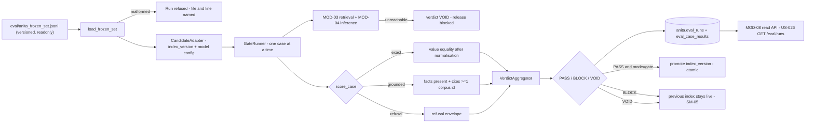

> **Lens:** PO / TPO (technical ACs) / Architect (HLD, LLD) · **Engagement:** Brownfield

# US-027 — Frozen evaluation set and release quality gate [Lens: PO]

- **Story:** As a **release owner**, I want **a versioned set of questions with known-correct answers, and a promotion gate that blocks the release when any of them regresses — especially any commercial answer**, so that **a wrong price or a fabricated specification can never reach a buyer, and a corpus or prompt change cannot be quietly promoted on a good feeling**.
- **Business value:** `BRD-22`, and through it `BRD-04` and `BRD-05`. `01-brd.md` §10 treats a hallucinated price as a liability event, not a bug: this gate is the only control that stands between a bad catalogue refresh and a buyer acting on a wrong figure. It also gives `WF-03`'s index promotion a decision procedure instead of a manual check.
- **Priority:** **Must** — TPO ordering note: the harness imports nothing from `app.*` (`REC-17` pattern), so it can be built in parallel with everything else; it must land before the first corpus refresh is promoted, and it is deliberately **out-of-band** — nothing on the conversation path awaits it.

## Acceptance Criteria [Lens: PO]

```gherkin
Scenario: A healthy candidate is promoted
  Given a frozen set of 90 cases and a candidate index that behaves correctly
  When the gate runs
  Then every case is scored against its ground truth
  And the verdict is PASS
  And the candidate index version is promoted atomically

Scenario: One exact commercial answer is wrong
  Given a candidate whose price answer for a product is wrong
  When the gate runs
  Then the verdict is BLOCK regardless of the pass rate
  And the failing case id and its expected and actual values are returned
  And the previously live index stays live

Scenario: The answer engine is unavailable
  Given the engine cannot be reached
  When the gate runs
  Then the verdict is VOID
  And the release is blocked
  And the run is recorded as void rather than omitted

Scenario: The frozen set is malformed
  Given a set file with a case missing its expected answer kind
  When the gate runs
  Then the run is refused before any question is asked
  And the file and the line are named

Scenario: Development run in report-only mode
  Given a candidate under development
  When the gate runs in report-only mode
  Then the results are recorded
  And no promotion occurs
  And the run is visibly marked report-only

Scenario: A run is already in flight
  Given a gate run that has not finished
  When a second gate run is started
  Then the second is refused
  And the first is not disturbed
```

Technical acceptance criteria [Lens: TPO]:

- **TAC-1:** The set is a versioned repo file (`eval/anita_frozen_set.jsonl`), never a database table; the run records `set_sha256`, so a promoted release can always be tied to the exact question set it passed.
- **TAC-2:** The verdict rules are structural and not configurable: **zero `exact` failures** is absolute; VOID always blocks. Only the pass-rate threshold and the time budget are configurable, and both default to `98 %` / `Assumed: 15 min`.
- **TAC-3:** An errored question counts as a **failure**, never as a skip or a pass (`UC-15` E1).
- **TAC-4:** Promotion is atomic: the verdict row and the candidate's `index_version` are written in one transaction; at no observable instant are both the old and the new index live, and a failed promotion leaves the old one live (`SM-05` #5, #6).
- **TAC-5:** The harness imports nothing from `app.*`/`anita.*` (`REC-17`); the candidate is exercised through a declared adapter interface, so a frozen candidate can be evaluated without booting the product.
- **TAC-6:** A complete 90-case run finishes within 15 min p95 on the target hardware, and the engine outage path is distinguishable from a slow path (VOID vs a still-running run).

## HLD — Architecture Slice [Lens: Architect]



- **Components touched:**
  - `eval/` harness — new: `FrozenSet`, `GateRunner`, `CandidateAdapter`, verdict aggregation. Zero `app.*` imports (`TAC-5`).
  - `MOD-03 Retrieval` + `MOD-04 Inference` — existing: reached only through the adapter, so the harness does not depend on their internals.
  - `MOD-08 read API` — existing: serves run history (`US-026`), including case-level failure lists.
  - `MOD-09` — existing: supplies the `anita` DSN, the corpus directory and the admin token; the promotion of an index version is the release-side half of `SM-05`.
- **Interaction summary:**
  1. The set is loaded and validated structurally before any question is asked; a malformed set refuses the run with its file and line.
  2. The candidate adapter is constructed for the requested `index_version`/config; the engine is probed.
  3. Each question is asked, answered and scored against its ground truth; every case's outcome is written per case.
  4. The verdict is computed from the outcomes under rules that cannot be waived (`TAC-2`).
  5. **Failure path:** an unreachable engine voids the whole run — nothing is promoted and the previous index stays live; a single errored question fails that case and can turn the verdict to BLOCK, but never to a pass.
  6. The run row is finalised in one transaction with the verdict; promotion, when it happens, is part of the same decision.

## LLD — Implementation Detail [Lens: Architect]

- **Classes / functions / APIs:**

```python
# eval/frozen_set.py  — no app.* / anita.* imports (TAC-5, REC-17)
AnswerKind = Literal["exact", "grounded", "refusal"]

@dataclass(frozen=True)
class EvalCase:
    id: str; question: str; answer_kind: AnswerKind
    channel_kinds: tuple[str, ...] = ("web",)
    expected_value: str | None = None          # required when kind == "exact"
    expected_source_ids: tuple[str, ...] = ()  # required when kind == "grounded"
    must_include: tuple[str, ...] = ()
    must_not_include: tuple[str, ...] = ()     # e.g. a price figure without the caveat

def load_frozen_set(path: Path) -> tuple[FrozenSet, str]: ...   # raises SetMalformed(line_no, reason)
def set_sha256(path: Path) -> str: ...
def validate(case: EvalCase) -> None: ...                       # structural rules per kind

# eval/scoring.py
def normalise(value: str) -> str: ...               # currency/decimal/whitespace normalisation
def score_exact(case, answer) -> CaseOutcome: ...
def score_grounded(case, answer, chunks) -> CaseOutcome: ...
def score_refusal(case, answer) -> CaseOutcome: ...
def score_case(case, answer, chunks) -> CaseOutcome: ...   # errored -> passed=False, status="errored"

# eval/gate.py
class CandidateAdapter(Protocol):
    @property
    def index_version(self) -> str: ...
    @property
    def model_config_hash(self) -> str: ...
    def probe(self) -> None: ...                     # raises EngineUnavailable
    def answer(self, question: str, *, channel_kind: str) -> CandidateAnswer: ...

@dataclass(frozen=True)
class Verdict:
    verdict: Literal["PASS", "BLOCK", "VOID"]; pass_rate: float
    failed_case_ids: tuple[str, ...]; blocking_reason: str

class GateRunner:
    def __init__(self, adapter: CandidateAdapter, cases: tuple[EvalCase, ...],
                 *, mode: Literal["gate", "report_only"] = "gate",
                 pass_rate_min: float = 0.98, budget_s: int = 900) -> None: ...
    def run(self) -> Verdict: ...                    # writes runs + per-case rows
    def verdict_for(self, outcomes) -> Verdict: ...  # pure; unit-testable without an engine

def promote(index_version: str, run_id: UUID) -> None: ...   # atomic with the verdict row

# eval/__main__.py
def main(argv: list[str]) -> int: ...   # --mode gate|report_only --candidate <label> --budget-s 900
```

- **Data schema changes:**

```sql
-- Owned by this story; anita.eval_runs is declared in MOD-08 Part B.
CREATE TABLE IF NOT EXISTS anita.eval_case_results (
    id                BIGSERIAL PRIMARY KEY,
    run_id            UUID NOT NULL REFERENCES anita.eval_runs(id) ON DELETE CASCADE,
    case_id           VARCHAR(64) NOT NULL,
    answer_kind       VARCHAR(16) NOT NULL CHECK (answer_kind IN ('exact','grounded','refusal')),
    status            VARCHAR(16) NOT NULL CHECK (status IN ('passed','failed','errored')),
    expected          TEXT DEFAULT '',
    actual            TEXT DEFAULT '',
    cited_source_ids  JSONB NOT NULL DEFAULT '[]',
    latency_ms        INTEGER,
    detail            TEXT DEFAULT '',
    UNIQUE (run_id, case_id)          -- re-running the same candidate is idempotent per case
);
CREATE INDEX IF NOT EXISTS ix_case_results_failed
    ON anita.eval_case_results(run_id) WHERE status <> 'passed';
```

- **Edge cases** (each with the decided behaviour):
  1. **Set file absent** → run refused: release blocked and cannot be silently skipped (`UC-15` missing-data row). A VOID is not written for an absent set; the command exits non-zero with `SetAbsent`.
  2. **Set file malformed (bad JSONL line, unknown `answer_kind`, missing `expected_value` for `exact`)** → refused before any question is asked, naming the file and line (`UC-15` invalid-input row).
  3. **Duplicate case id within one set** → refused at load; a duplicated id would let a failure hide behind a pass.
  4. **A question errors** → `status='errored'`, counted as a failure (`UC-15` E1, `TAC-3`); the run cannot be `PASS` if any case errored (`TRD-40`).
  5. **Engine unreachable at probe** → single `VOID` with `blocking_reason='engine unavailable'`; per-case rows are not fabricated (`UC-15` E2).
  6. **Engine dies mid-run** → cases already completed keep their outcomes; the run finalises `VOID`, never a partial `PASS` (`UC-15` timeout/dependency rows).
  7. **Budget exceeded (15 min)** → run is `VOID`, the release is blocked, and the incomplete case list is recorded (`UC-15` timeout row).
  8. **Second run while one is in flight** → refused by the partial unique index; the caller gets the in-flight run id (`UC-15` concurrent row, `TRD-40`).
  9. **Same candidate re-run after completion** → allowed and idempotent, producing a new run row with the same `set_sha256`; a re-run after a BLOCK is how a fix is proven (`UC-15` retry row).
  10. **`exact` case whose actual value differs only in formatting (`₹5,50,000` vs `550000`)** → passes after normalisation, because a formatting difference is not a wrong price; a different numeric value never passes.
  11. **`must_not_include` violated (a price answer missing the caveat)** → case fails even though `expected_value` matched (`BRD-06`).
  12. **`grounded` answer citing zero corpus records** → fails regardless of prose similarity (`BRD-04`).
  13. **`refusal` case where the engine answers instead of refusing (a clinical question)** → fails; the refusal envelope is the expected answer (`BRD-04`, clinical boundary).
  14. **Report-only mode** → verdict recorded, `mode='report_only'`, promotion skipped by construction (`UC-15` A1).
  15. **Promotion fails after a PASS verdict** → the verdict row stays `PASS` but `index_version` promotion is rolled back with it; the previous index is still live and the failure is alerted (`SM-05` #5). The run is not rewritten to hide the failure.
  16. **Cancellation (operator aborts)** → the run finalises `VOID`; nothing is promoted; the partial per-case rows remain for diagnosis (`UC-15` cancellation row).
  17. **90 cases at ~9 s each** → ~13.5 min, inside the 15-min budget; if the observed p95 pushes past it, the budget is raised by configuration and the change is visible in the run row (`TAC-6`).

- **Error handling:**
  - `SetAbsent` / `SetMalformed(line_no, reason)` — refuse the run; exit non-zero; no `eval_runs` row.
  - `EngineUnavailable` — `VOID` verdict with the engine's error, release blocked.
  - `RunInFlight` — raised from the partial unique index violation; the caller is told the in-flight run id.
  - `BudgetExceeded` — `VOID`; incomplete cases enumerated.
  - `PromotionFailed` — `VOID`-equivalent for release purposes: the run keeps its `PASS` but no index changes; ops alert.
  - No error path mutates the frozen set; the set is opened read-only (`TAC-1`).

- **Test scenarios** (floor = every `✓` row of the `UC-15` Scenario Coverage table):
  - *Unit* — happy path: 90 real cases against a stub adapter that answers correctly → `PASS`, all rows `passed`.
  - *Unit* — alternate A1: report-only mode → results recorded, `promote` never called (spy asserts zero calls).
  - *Unit* — invalid input: a case with `answer_kind="exact"` and no `expected_value` → `SetMalformed` naming the line; no engine call.
  - *Unit* — unauthorized user: the gate is an ops-only command/endpoint; without the admin token the run route is 401 (`DG-06`, CV-03).
  - *Unit* — missing data: set file absent → `SetAbsent`, exit non-zero, no run row, release blocked.
  - *Unit* — partial data: 3 of 90 cases errored → verdict `BLOCK`, `errored=3`, failing ids listed.
  - *Unit* — duplicate request: re-running the same candidate after completion → a second run row with the same `set_sha256`; per-case outcomes identical.
  - *Unit* — timeout: budget forced to 2 s with a slow stub → `VOID`, incomplete ids recorded.
  - *Unit* — dependency failure: adapter `probe()` raises → `VOID` with reason, zero per-case rows.
  - *Unit* — retry: after a BLOCK, the fixed candidate re-runs → `PASS`; both runs visible in history.
  - *Unit* — concurrent operation: two `GateRunner.run()` calls in parallel → one wins, the other raises `RunInFlight` with the winner's id.
  - *Unit* — cancellation: abort mid-run → `VOID`, no promotion, partial rows retained.
  - *Unit* — recovery: the previously live index version is unchanged across every one of the above failure cases (`SM-05` `LIVE` invariant).
  - *Unit* — partial completion: promotion transaction rolled back after a fabricated failure → no index version changed, verdict row and promotion are all-or-nothing.
  - *Unit* — scoring: `₹5,50,000` vs `550000` passes normalisation; `₹5,50,000` vs `₹2,00,000` fails.
  - *Unit* — scoring: a price answer missing the mandatory caveat fails `must_not_include`/`must_include` even with the right figure (`BRD-06`).
  - *Unit* — scoring: a grounded answer citing zero corpus records fails (`BRD-04`).
  - *Unit* — scoring: a clinical question answered instead of refused fails; the refusal envelope passes.
  - *Integration* — harness isolation: running `eval/` with every `app.*` import poisoned still loads the set and runs against the adapter (`REC-17`, `TAC-5`).
  - *Integration* — a deliberately broken candidate (one price off by ₹10,000) → `BLOCK` despite a 98.9 % pass rate, because an `exact` failure is absolute (`TAC-2`).
  - *Integration* — a candidate missing 4 FAQ answers → pass rate 95.6 % → `BLOCK`; the 4 ids are returned, not a bare count.
  - *E2E* — `WF-03`: a corpus refresh is re-indexed (`SM-05` `VALIDATING`), the gate runs against the candidate, PASS promotes it, and the previous index serves traffic throughout.
  - *E2E* — a refresh whose gate is BLOCKed leaves `SM-05` at `REJECTED`, the old index intact, and a run visible in the console's eval history (`US-026`).
  - *Load* — 90 cases with the engine at its normal latency → p95 run duration ≤ 15 min, per-case overhead ≤ 50 ms excluding engine time (`TAC-6`).

## Traceability
- Parent module: `MOD-08`
- Use case: `UC-15` · technical requirements: `TRD-39`, `TRD-40`
- Business requirement: `BRD-22`, `BRD-04`, `BRD-05`, `BRD-06`
- Data gap / state machine: `DG-13` (the 3 products with no published specs are cases expecting the honest "not published" answer, not skips), `DG-06` (ops-only action), `SM-05` (`VALIDATING` → `LIVE` | `REJECTED`; previous configuration live throughout), `WF-03` steps 3–4
- Reconciliation: `REC-17` (`pattern-only` — the university's 137-case golden set is **not** transferable; the harness pattern is retained, the cases are rebuilt from `data/out/` and `REC-23`'s validation gate), `REC-23` (corpus validation feeds the set)
- Data assets: `DAT-12` (the vector index version under promotion), `DAT-01`, `DAT-02`, `DAT-03` (the corpus chunks and commercial/specification facts behind each case's expected answer)

## Definition of Done
- [ ] All ACs pass (AC-1 … AC-6, TAC-1 … TAC-6)
- [ ] Tests from the LLD test scenarios pass, including the one-exact-failure-blocks-despite-98.9 % case and the harness import-isolation test
- [ ] Load test passed: 90 cases within the 15-min budget, p95 (TAC-6)
- [ ] Schema migration applied (`eval_case_results` + index; `eval_runs` per MOD-08 Part B)
- [ ] Seed set committed at `eval/anita_frozen_set.jsonl` with 90 cases per `TRD-39`'s composition, reviewed by the PO
- [ ] Verified end to end against a real `WF-03` re-index: PASS promotes, BLOCK/VOID leave the previous index live
- [ ] Module docs updated if the verdict rules or set schema changed
