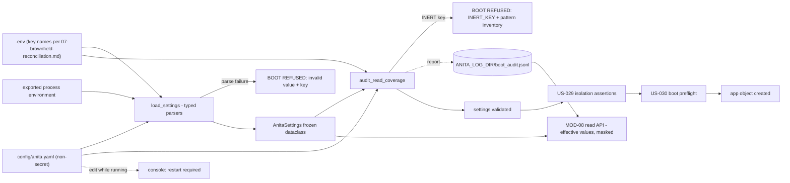

> **Lens:** PO / TPO (technical ACs) / Architect (HLD, LLD) · **Engagement:** Brownfield

# US-028 — One typed configuration source, and a boot that refuses keys nobody reads [Lens: PO]

- **Story:** As an **ops admin**, I want **every setting to come from one typed source that names the offending key when a value is wrong, and a boot that refuses to start when a key is written but nothing reads it**, so that **a typo or a forgotten setting is a five-second fix at boot instead of a wrong behaviour discovered by a buyer**.
- **Business value:** `BRD-20` and `DG-09`. The source product's audit evidence is exactly this failure: keys written in configuration that no code path ever reads, silently doing nothing. For ANITA the cost of a silent config miss is concrete — an outbound window that never applies, an escalation threshold that never fires, an admin token that is set but not enforced. This story makes those failures impossible to ship in ignorance.
- **Priority:** **Must** — TPO ordering note: it is the first thing that runs, so it must land before any module relies on a setting; US-026 renders its audit result, and US-029/US-030 consume its `AnitaSettings` object.

## Acceptance Criteria [Lens: PO]

```gherkin
Scenario: A correct configuration boots
  Given a complete configuration with every key read by code
  When the instance starts
  Then the effective settings are loaded from the single source
  And the boot proceeds to the isolation check

Scenario: A key is written but nobody reads it
  Given a key set in the environment that no code path reads
  When the instance starts
  Then the boot is refused
  And the refusal names the key and where it was written

Scenario: A value cannot be parsed
  Given ANITA_API_PORT set to a non-numeric value
  When the instance starts
  Then the boot is refused
  And the refusal names ANITA_API_PORT and the expected type
  And no port is bound

Scenario: A required secret is missing
  Given no admin token configured
  When the instance starts
  Then the boot is refused naming the key
  And no secret value appears anywhere in the output

Scenario: A value changes while the instance is running
  Given a running instance
  When an operator edits a configuration file
  Then the running instance keeps its effective values
  And the console reports that a restart is required
  And the effective values it reports are the running process's, not the file's

Scenario: Config audit is inspectable
  Given a boot that would succeed
  When the operator opens the configuration panel
  Then each key is listed as live, and each inert key with the reason
  And the auditor's read-detection patterns are shown
  And no secret value is displayed
```

Technical acceptance criteria [Lens: TPO]:

- **TAC-1:** `AnitaSettings` is a `@dataclass(frozen=True)`; every field is loaded through a typed parser that **names the key and the expected type** on failure. There are no silent coercion defaults (`M9-3`).
- **TAC-2:** The read-coverage audit is closed by default: a key found in the environment or a config file with no detected read is `INERT` and refuses the boot with `INERT_KEY: <name>` (`DG-09`, `M9-2`). Only the audit's own pattern inventory is configurable — never the resolution of a specific key.
- **TAC-3:** Assignment is not a read: `os.environ["K"] = x` must not count as a read of `K` (the source's documented false-positive fix, retained).
- **TAC-4:** Secrets (`ANITA_ADMIN_TOKEN`, `TWILIO_AUTH_TOKEN`) are never rendered, logged or echoed; a startup self-check greps the rendered config block and any log line for their values and fails hard on a hit (`M9-4`).
- **TAC-5:** The audit is deterministic and side-effect-free: it opens no socket, no DB connection and no file outside the config set, so it can run in the preflight process (US-030) without touching the live instance.
- **TAC-6:** The audit adds ≤ 300 ms (Assumed) p95 to boot and reports its own pattern inventory on every refusal.
- **TAC-7:** The CRM block excised by `REC-06` does not appear in `AnitaSettings`: no `CRM_BASE_URL`, `CRM_API_KEY`, `CRM_TIMEOUT_*` or picklist key is present, parsed, or accepted.

## HLD — Architecture Slice [Lens: Architect]



- **Components touched:**
  - `MOD-09 AnitaSettings` — new: a frozen typed dataclass and its parser helpers (`REC-14` reuse of the `app/config.py` pattern, CRM block excised).
  - `MOD-09 ConfigAuditor` — new: the read-coverage audit and pattern inventory (`REC-14` reuse of `app/config_truth.py`).
  - `MOD-09 boot sequence` — new: `load → audit → isolate → preflight → create app`, so a refusal happens before any resource is touched (`M9-6`).
  - `MOD-08 read API` — existing: serves the effective values and the audit report, masked.
  - Every other module — existing: reads settings only through `AnitaSettings`, never `os.environ` directly (the audit depends on that property).
- **Interaction summary:**
  1. On boot, settings are loaded with precedence **process environment > env file > config file > declared default**; the source of each effective value is recorded.
  2. Every parse is typed; a bad value refuses the boot naming the key, the raw value and the expected type.
  3. The auditor scans the same three sources for keys and cross-references detected reads in the codebase; any key written but never read refuses the boot and prints the pattern inventory.
  4. The effective settings object is frozen and handed to the rest of the boot sequence.
  5. **Failure path:** a refusal exits non-zero before any port is bound, any DB connection is opened and any log line containing a secret is written (`TAC-4`).

## LLD — Implementation Detail [Lens: Architect]

- **Classes / functions / APIs:**

```python
# app/anita/config/settings.py   (REC-14: app/config.py pattern, CRM block excised)
def _env(key: str, default: str | None = None) -> str: ...
def _env_int(key: str, default: int | None = None) -> int: ...
def _env_float(key: str, default: float | None = None) -> float: ...
def _env_bool(key: str, default: bool = False) -> bool: ...
# each raises ConfigInvalid(key, raw, expected) — never a silent fallback (TAC-1)

@dataclass(frozen=True)
class IsolationSettings:
    db_name: str; db_schema: str; chroma_path: str; chroma_collection: str
    api_port: int; chat_port: int; admin_port: int; log_dir: str

@dataclass(frozen=True)
class AnitaSettings:
    isolation: IsolationSettings
    company_name: str; agent_name: str
    outbound_max_attempts: int            # OUTBOUND_MAX_ATTEMPTS, default 3
    outbound_window_start: time           # 10:00
    outbound_window_end: time             # 19:00
    outbound_timezone: str                # Asia/Kolkata
    outbound_poll_interval: int           # 10
    outbound_retry_delays_min: tuple[int, ...]   # (240, 1440)
    sentiment_w1: float; sentiment_w2: float
    sentiment_w3: float; sentiment_w4: float      # 0.30/0.30/0.25/0.15
    sentiment_ewma_lambda: float                  # 0.35
    negative_escalation_threshold: float          # -0.20
    llm_provider: str                     # derived by US-030, not hand-set
    ollama_model: str; embed_model: str; mlx_model: str; mlx_base_url: str; mlx_port: int
    admin_token: str                      # ANITA_ADMIN_TOKEN, secret
    require_admin: bool                   # derived: True on non-dev boots

    def sources(self) -> dict[str, str]: ...       # key -> which source supplied it
    def masked_dump(self) -> dict[str, str]: ...   # secret values replaced by "***"

class ConfigInvalid(ValueError):  # .key, .raw, .expected
    ...

def load_settings() -> AnitaSettings: ...          # raises ConfigInvalid / ConfigAbsent

# app/anita/config/audit.py   (REC-14: app/config_truth.py pattern, false-positive fixes intact)
SECRET_MARKERS = re.compile(r"TOKEN|SECRET|PASSWORD|PASSWD|PASS|KEY|CREDENTIAL|SID|AUTH")

@dataclass(frozen=True)
class AuditReport:
    live: dict[str, str]             # key -> read site
    inert: tuple[str, ...]           # written, never read  -> boot refusal
    pattern_inventory: tuple[str, ...]   # the helper shapes that count as reads
    unparsed: tuple[str, ...]        # keys present in a source but outside AnitaSettings
    masking_false_positive_classes: tuple[str, ...]

def audit_read_coverage(settings: AnitaSettings, *,
                        env_file: Path, config_file: Path,
                        code_root: Path) -> AuditReport: ...
def emit_boot_audit(report: AuditReport, path: Path) -> None: ...   # JSONL, best-effort

# app/anita/boot/sequence.py
def boot(mode: Literal["serve", "preflight"] = "serve") -> AnitaSettings:
    settings = load_settings()
    report = audit_read_coverage(settings, ...)
    if report.inert:
        raise BootRefused("INERT_KEY", report)
    assert_isolation(settings)          # US-029
    preflight(settings)                 # US-030
    return settings
```

- **Data schema changes:** none in Postgres. The audit report is an append-only JSONL line under `ANITA_LOG_DIR` (`boot_audit.jsonl`), written best-effort so an unwritable log directory cannot turn a successful boot into a failure; the refusal message itself is printed to stderr and is always available.

```json
{"event":"boot_audit","at":"2026-10-03T09:12:04Z","result":"refused",
 "reason":"INERT_KEY","inert":["OUTBOUND_POLL_INTERVAL"],
 "live_count":41,"inert_count":1,
 "pattern_inventory":["_env(","_env_int(","_env_float(","_env_bool(","settings.<field>"],
 "sources":{"ANITA_API_PORT":"env_file","SENTIMENT_W1":"config_file"}}
```

- **Edge cases** (each with the decided behaviour):
  1. **Key set in the config file but shadowed by the environment** → the effective value is the environment's; `sources()` reports it, so an operator can see why the file "did nothing".
  2. **Key set to an empty string** → treated as set-and-invalid for required keys (refusal), and as an explicit "unset" only for optional keys whose default is documented; a required secret is never satisfied by an empty string (`M9-4`).
  3. **Key written with a typo (`ANITA_API_PROT`)** → outside `AnitaSettings` and not read by anything → `INERT_KEY` refusal, naming the key; the message suggests the nearest live key.
  4. **A false positive: assignment counted as a read** → explicitly excluded (`TAC-3`); a test asserts `os.environ["X"] = "1"` does not mark `X` live.
  5. **A false positive: a value read through a typed helper** → counted as a read, and the helper shape is printed in the pattern inventory so an operator can see why (`DG-09`).
  6. **A secret value appears in a log line** → the startup self-check fails hard (`AC-M9-7`); the refusal quotes the key, never the value.
  7. **Config file absent** → ANITA ships without it and every non-isolation default is declared in code; isolation keys have no usable default and an absent/blank one is a refusal rather than an inherited value (`TRD-42`).
  8. **Config file edited while running** → not picked up; the console reports "restart required" and the effective values are the process's (`M9-7`).
  9. **Two sources disagree on a port** → process env wins; `sources()` names the winner and the shadowed value is listed under `unparsed` so the disagreement is visible rather than silent.
  10. **A key exists in the environment for the university product** (e.g. `DB_NAME=admissions`) → it is not in `AnitaSettings` and not read here; it is `INERT` **only if** it sits in ANITA's own env file. A sibling's process environment is not ANITA's configuration and is never read (`REC-21`).
  11. **`INERT_KEY` on a key that genuinely has no consumer yet** → the boot refuses; the fix is to remove the key or land the consumer, and the refusal text says so. There is no per-key waiver (`TAC-2`).
  12. **Audit itself throws** → treated as a refusal (`BootRefused("AUDIT_ERROR")`), never as a pass: an audit that cannot run is not evidence that the configuration is clean.

- **Error handling:**
  - `ConfigInvalid(key, raw, expected)` — printed as a `BOOT REFUSED — invalid configuration value` block; the raw value is shown only for non-secret keys.
  - `BootRefused(reason, report)` — the single refusal type for both `INERT_KEY` and `AUDIT_ERROR`; prints the block plus the pattern inventory.
  - `ConfigAbsent(key)` — a required key with no source anywhere; a specific message, distinct from an invalid value.
  - `SecretLeakDetected(key)` — raised by the startup self-check; the process exits before serving (`TAC-4`).

- **Test scenarios** (floor = every `✓` row of the `UC-12` Scenario Coverage table, from the configuration surface this story owns):
  - *Unit* — happy path: a complete environment loads; every field typed; `sources()` populated.
  - *Unit* — invalid input: `ANITA_API_PORT="eighty-one hundred"` → `ConfigInvalid` naming key, raw and expected type.
  - *Unit* — missing required secret: unset `ANITA_ADMIN_TOKEN` → refusal naming the key; the output contains no value (grep assertion).
  - *Unit* — audit: a key written in the env file with no read → `INERT_KEY` refusal; `pattern_inventory` non-empty.
  - *Unit* — audit false positives: a `_env_int` read counts; an `os.environ["K"]=x` assignment does not (TAC-3).
  - *Unit* — audit determinism: running the audit twice over the same inputs yields byte-identical reports (TAC-5).
  - *Unit* — precedence: the same key in all three sources → process env wins and `sources()` says so.
  - *Unit* — no silent default: a key with a garbage value and a documented default still refuses (no fallback-on-parse-error).
  - *Unit* — CRM excision: a grep of the package finds no `CRM_BASE_URL`, `CRM_API_KEY`, `CRM_TIMEOUT_` or picklist identifier (TAC-7, `REC-06`).
  - *Unit* — masking: `masked_dump()` renders `ANITA_ADMIN_TOKEN` as `***`; the marker-based masking leaves `ANITA_COMPANY_NAME` readable.
  - *Integration* — unauthorized user: the config panel requires the admin token (`DG-06`, CV-03); the refusal path itself needs no auth because it happens before the app exists.
  - *Integration* — missing data (UC-12 row): a boot with no traces still loads settings and renders the config panel with an empty live/inert split, not an error.
  - *Integration* — partial data (UC-12 row): a configuration where 2 of 43 keys are inert → refusal lists exactly those 2, in the audit report order.
  - *Integration* — duplicate request (UC-12 row): two audits in one boot (preflight then serve) produce identical reports; neither mutates state.
  - *Integration* — timeout (UC-12 row): audit forced to exceed 5 s → refuses with `AUDIT_ERROR`, no port bound.
  - *Integration* — dependency failure (UC-12 row): audit cannot read the env file (permissions) → refusal, never a pass.
  - *Integration* — retry (UC-12 row): after the operator fixes the key, the next boot succeeds; the console's auto-refresh shows the corrected report.
  - *Integration* — concurrent operation (UC-12 row): two preflight processes audit at once → both succeed, neither writes a partial report.
  - *Integration* — cancellation (UC-12 row): an operator aborts a boot mid-audit → no port bound, no partial `boot_audit.jsonl` line.
  - *Integration* — recovery (UC-12 row): a refused boot is followed by a clean boot; the console's panel reflects the effective values of the running process.
  - *Integration* — partial completion (UC-12 row): audit report written, isolation check (US-029) refuses → the audit line exists, the boot is refused, nothing else ran.
  - *E2E* — an operator adds `OUTBOUND_POLL_INTERVAL_SECONDS=10` (a plausible typo) to the env file → boot refuses, names the key, suggests `OUTBOUND_POLL_INTERVAL`, and no service is reachable at any ANITA port while refused.
  - *Load* — 50 consecutive boots with the audit enabled → p95 boot overhead ≤ 300 ms over the audit-disabled baseline (TAC-6).

## Traceability
- Parent module: `MOD-09`
- Use case: `UC-12` · technical requirement: `TRD-41`
- Business requirement: `BRD-20`
- Data gap / state machine: `DG-09` (this story is the mitigation — configured-but-unread keys), `DG-06` (the config surface is admin-only)
- Reconciliation: `REC-14` (`reuse` — `app/config.py` + `app/config_truth.py` patterns retained; the CRM block excised per `REC-06`), `REC-21` (no `.env` file of the sibling is ever read; only ANITA's own sources are audited)
- Data asset: `DAT-13` (configuration: key inventory, sources, mask states)

## Definition of Done
- [ ] All ACs pass (AC-1 … AC-6, TAC-1 … TAC-7)
- [ ] Tests from the LLD test scenarios pass, including the inert-key refusal, the assignment-is-not-a-read case and the secret-grep failure
- [ ] Load test passed: ≤ 300 ms p95 boot overhead (TAC-6)
- [ ] No schema migration (by design — configuration is not a database table)
- [ ] Manual check: cutting `OUTBOUND_POLL_INTERVAL` from the code while leaving it configured refuses the boot with the key named
- [ ] Module docs updated if `AnitaSettings`' field set changed
