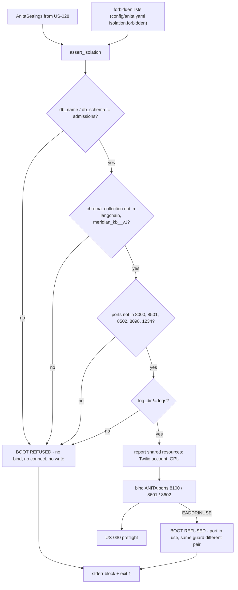

> **Lens:** PO / TPO (technical ACs) / Architect (HLD, LLD) · **Engagement:** Brownfield

# US-029 — Isolation guard: refuse to boot rather than touch the other product's data [Lens: PO]

- **Story:** As an **ANITA platform owner**, I want **the instance to refuse to start when any of its four shared-resource coordinates (database, vector collection, ports, log path) collides with the university product's**, so that **a copy-pasted configuration can never write ANITA's leads into the admissions database, serve on the university's port, or bury its logs in the shared directory**.
- **Business value:** `BRD-18` and `CV-01`. Both products share one box, one GPU and one Twilio account — the isolation that matters is the resource naming, and it is exactly the thing a hurry breaks. The failure mode is not a crash: it is silent cross-contamination, which `06-architecture.md` names as the one brownfield risk with no second chance.
- **Priority:** **Must** — TPO ordering note: it runs after `US-028` has produced an `AnitaSettings` object and before anything binds a port (`M9-6`), so it must land before any channel adapter story can start a listener.

## Acceptance Criteria [Lens: PO]

```gherkin
Scenario: A distinct configuration boots
  Given ANITA's own database, schema, collection, ports and log directory
  When the isolation guard runs
  Then every resource is confirmed distinct from the university product's
  And the boot proceeds

Scenario: The vector collection collides
  Given ANITA_CHROMA_COLLECTION left at "langchain"
  When the instance starts
  Then the boot is refused
  And the refusal names the collection and the sibling value it collides with
  And no port is bound and no database connection is opened
  And no ANITA code runs after the refusal

Scenario: A port collides
  Given the ANITA API port set to 8000
  When the instance starts
  Then the boot is refused
  And the refusal names the port and the ANITA key that set it

Scenario: The log directory collides
  Given ANITA_LOG_DIR left at "logs"
  When the instance starts
  Then the boot is refused
  And the refusal names the path and directs the operator to a product-specific directory

Scenario: Two ANITA instances on one box
  Given one ANITA instance already listening
  When a second is started with the same ports
  Then the second refuses and names the port
  And the first is unaffected

Scenario: A shared resource is legitimately shared
  Given the Twilio account and the GPU are shared by design
  When the isolation guard runs
  Then neither is treated as a collision
  And the guard's report states that they are shared
```

Technical acceptance criteria [Lens: TPO]:

- **TAC-1:** `assert_isolation()` runs before the app object is created, before any socket bind, and before any DB connection or file write. A spy test proves the ordering: on a collision, zero sockets are bound and zero DB connections are opened.
- **TAC-2:** Four resource classes are compared, each against an explicit forbidden value list sourced from configuration, not from reading the sibling's files or process environment (`REC-21`):
  - database name / schema vs `admissions`
  - vector collection vs `langchain`, `meridian_kb__v1`
  - ports vs `8000`, `8501`, `8502`, `8098`, `1234`
  - log directory vs `logs`
- **TAC-3:** Every refusal prints the fixed block shape `BOOT REFUSED — isolation collision (BRD-18)` naming the resource, the ANITA value, the sibling value and a concrete action; exit code is non-zero.
- **TAC-4:** No ANITA process touches a sibling resource path: the guard's own code opens only ANITA's config files, and the deny-list is data (so tightening it is a config change, not a code change).
- **TAC-5:** Isolation is **logical**, not total: the Twilio account and the shared GPU are explicitly listed as shared in the guard's report; sharing them is never a refusal, and the GPU budget check belongs to US-030.
- **TAC-6:** The hard-coded ports and the external-repo clone at the source's `bootstrap_services.py` Step 4b are removed (`REC-18`); every port the instance uses comes from `AnitaSettings`.

## HLD — Architecture Slice [Lens: Architect]



- **Components touched:**
  - `MOD-09 IsolationGuard` — new: the four comparisons, the refusal block, the shared-resource report.
  - `MOD-09 boot sequence` — existing (`US-028`): calls the guard between settings load and preflight.
  - `config/anita.yaml` — new: the `isolation.forbidden` deny-lists, owned by the operator.
  - `bootstrap_services.py` — refactor (`REC-18`): hard-coded ports and the Step 4b external-repo clone removed; ports read from `AnitaSettings`.
  - `MOD-08 read API` — existing: reports the guard's result and the shared-resource list in the configuration panel.
- **Interaction summary:**
  1. The guard receives the frozen settings and the deny-lists (data, not code).
  2. It compares each of the four resource classes; the first collision produces the refusal block and exits.
  3. On a clean comparison it emits the shared-resource report (Twilio account, GPU) and returns.
  4. Ports are only bound afterwards; a bind failure (a second instance, or an unrelated process) raises the same refusal shape with the port and its owning key.
  5. **Failure path:** every refusal happens before any resource is touched, so a refused boot cannot have written a lead, opened a collection, or truncated a log file.

## LLD — Implementation Detail [Lens: Architect]

- **Classes / functions / APIs:**

```python
# app/anita/config/isolation.py
@dataclass(frozen=True)
class ForbiddenValues:
    db_names: tuple[str, ...]                       # ("admissions",)
    collections: tuple[str, ...]                    # ("langchain", "meridian_kb__v1")
    ports: tuple[int, ...]                          # (8000, 8501, 8502, 8098, 1234)
    log_dirs: tuple[str, ...]                       # ("logs",)

class IsolationCollision(RuntimeError):
    resource: str; anita_value: str; sibling_value: str; owning_key: str
    def render(self) -> str: ...                    # the fixed BOOT REFUSED block (TAC-3)

SHARED_BY_DESIGN = (
    ("twilio_account", "SID/token are ANITA's own credentials on a shared provider account"),
    ("gpu", "16,311 MiB shared with the sibling; the ANITA budget is asserted in preflight"),
)

def normalise_path(p: str) -> str: ...               # resolve, strip trailing sep, case-fold on Windows
def assert_isolation(settings: AnitaSettings,
                     forbidden: ForbiddenValues) -> IsolationReport: ...
def bind_isolation(settings: AnitaSettings) -> None: ...   # after the guard; wraps EADDRINUSE

@dataclass(frozen=True)
class IsolationReport:
    checked: tuple[str, ...]; shared: tuple[tuple[str, str], ...]
```

- **Data schema changes:** none in Postgres; the guard runs before any connection exists. Its outcome is one JSONL line under `ANITA_LOG_DIR/boot_audit.jsonl` (the `US-028` shape, best-effort), and the refusal block is printed to stderr unconditionally.

```text
BOOT REFUSED — isolation collision (BRD-18)
  resource : chroma_collection
  anita    : langchain
  sibling  : langchain
  action   : set ANITA_CHROMA_COLLECTION to a value unique to this product (e.g. anita_ams__v1)
```

- **Edge cases** (each with the decided behaviour):
  1. **Trailing separator or case difference in the log path (`logs/` vs `logs`)** → normalised before comparison, so a cosmetic difference does not slip past the guard; on Windows the comparison is case-insensitive, as the filesystem is.
  2. **Relative vs absolute log path** → both resolved against the process working directory before comparison.
  3. **Collection name that merely contains a forbidden token (`anita_langchain_notes`)** → **not** a collision: the comparison is exact-equality on the normalised name, so a legitimately descriptive name is not refused, but the guard's report lists near-misses for the operator.
  4. **Port equal to a forbidden port on a different protocol** → still a collision; ports are a single namespace on the box.
  5. **ANITA's two ports set equal to each other (`chat_port == api_port`)** → refused as a self-collision, with the same block shape (own key named twice).
  6. **Port already in use by an unrelated process** → `bind_isolation` refuses with the port and the owning key; the process is not killed and no fallback port is silently chosen.
  7. **Two ANITA instances, same config** → the second refuses at bind; the first is untouched (`UC-12`-adjacent operational case, `M9-1`).
  8. **Deny-list empty** → the guard still runs; with nothing forbidden it reports "no deny-list entries configured" and the boot succeeds. This is a deliberate operator choice, not a silent default — the shipped `config/anita.yaml` seeds all four lists.
  9. **A deny-list entry is malformed (`"8000"` instead of `8000`)** → config refusal at load (`US-028`), not a silently ignored entry.
  10. **Sibling values are not readable / not installed on this box** → irrelevant: the guard never reads the sibling (`TAC-4`); the deny-list is what the operator declares.
  11. **Shared Twilio account with an identical messaging service SID used by the sibling** → out of the guard's scope; the credentials are ANITA's own and the report marks the account as shared rather than refusing (`TAC-5`). A collision on the *phone number* is a provider-side conflict and surfaces as a channel enable failure (UC-14), not a boot refusal.
  12. **Isolation values changed while running** → not re-checked; the values are boot-fixed (`M9-7`) and a restart re-runs the guard.
  13. **The guard itself throws** → refusal (`BootRefused("ISOLATION_ERROR")`); an isolation check that cannot run is not a pass.

- **Error handling:**
  - `IsolationCollision(resource, anita_value, sibling_value, owning_key)` — rendered by `render()`; carries the owning ANITA key so the fix is unambiguous (`AC-M9-3`).
  - `SelfCollision(key_a, key_b)` — a subclass for two ANITA keys set to the same port.
  - `PortInUse(port, owning_key)` — raised from `bind_isolation`; same block shape.
  - `SharedResourceConflict` — reserved: raised only if a future shared resource requires a budget that cannot be met (that check is US-030's).

- **Test scenarios** (floor = every `✓` row of the `UC-12` Scenario Coverage table, from the isolation surface this story owns; the guard is also the enforcement behind the config panel's isolation view):
  - *Unit* — happy path: ANITA's shipped values (`anita_ams`/`anita`, `anita_ams__v1`, 8100/8601/8602, `logs/anita`) → `IsolationReport` with all four classes checked and no collision.
  - *Unit* — invalid input: `ANITA_CHROMA_COLLECTION="meridian_kb__v1"` → `IsolationCollision` naming the collection and the sibling value.
  - *Unit* — invalid input: `ANITA_API_PORT=8000` → collision naming the port and `ANITA_API_PORT`.
  - *Unit* — invalid input: `ANITA_LOG_DIR="logs/"` → collision after normalisation; a Windows case variant (`Logs`) also collides.
  - *Unit* — invalid input: `ANITA_DB_NAME="admissions"` → collision; `ANITA_DB_SCHEMA="admissions"` → collision.
  - *Unit* — no false positive: `anita_langchain_notes` and `meridian_kb__v1_archive` are distinct names and boot cleanly.
  - *Unit* — self-collision: `chat_port == api_port` → refusal naming both keys.
  - *Unit* — shared resources: the report lists the Twilio account and the GPU as shared and neither is a refusal (TAC-5).
  - *Unit* — message shape: `render()` is asserted verbatim against `TRD-42`'s block (TAC-3).
  - *Integration* — ordering (TAC-1): with a forced collision, a socket spy sees zero binds and a DB spy sees zero connections; nothing is written under any log directory.
  - *Integration* — unauthorized user: the refusal path predates the app, so it needs no auth; the console's isolation view is admin-only (`DG-06`, CV-03).
  - *Integration* — missing data (UC-12 row): no `config/anita.yaml` forbidden block → the guard runs with the built-in default lists and reports which lists it used.
  - *Integration* — partial data (UC-12 row): a deny-list with only the database entry → the other three classes are still checked against their built-in defaults.
  - *Integration* — duplicate request (UC-12 row): running the guard twice in one boot (preflight then serve) yields identical reports; no state changes.
  - *Integration* — timeout (UC-12 row): guard forced to exceed its budget (300 ms Assumed) → refusal, no bind attempted.
  - *Integration* — dependency failure (UC-12 row): the guard's config read fails → refusal, never a pass.
  - *Integration* — retry (UC-12 row): the operator fixes the colliding value → the next boot passes; the console auto-refresh shows the corrected isolation report.
  - *Integration* — concurrent operation (UC-12 row): two preflights in parallel → both pass; two serving boots with the same ports → the second refuses at bind, the first keeps serving.
  - *Integration* — cancellation (UC-12 row): a boot aborted before the guard finishes → no port bound, no partial audit line.
  - *Integration* — recovery (UC-12 row): after a refused boot, a corrected boot serves; the refusal line remains in `boot_audit.jsonl` for diagnosis.
  - *Integration* — partial completion (UC-12 row): guard passes, preflight (US-030) refuses → the guard's report stands, the boot is refused, no service is reachable.
  - *E2E* — `bootstrap_services.py` after `REC-18`: the script starts ANITA using `AnitaSettings` ports only, performs no external-repo clone, and a grep finds no literal `8000`/`8501`/`8502`/`8098`/`1234` port constant (TAC-6).
  - *Load* — 50 boots with the guard enabled → p95 guard cost ≤ 50 ms; no measurable difference against the guard-disabled baseline beyond that.

## Traceability
- Parent module: `MOD-09`
- Use case: `UC-12` · technical requirement: `TRD-42`
- Business requirement: `BRD-18`
- Constraint / state: `CV-01` (isolation is logical — own DB/schema/collection/ports/log path; the Twilio account and GPU are shared by design), `M9-1`, `M9-6`, `M9-7`
- Reconciliation: `REC-18` (`refactor` — `bootstrap_services.py`: hard-coded ports removed, external-repo clone at Step 4b removed), `REC-21` (the sibling's files are never read; the deny-list is declared data), `REC-03` (the university's Chroma collections are named in the deny-list)
- Data asset: `DAT-13` (configuration: isolation values and the deny-lists)

## Definition of Done
- [ ] All ACs pass (AC-1 … AC-6, TAC-1 … TAC-6)
- [ ] Tests from the LLD test scenarios pass, including the zero-bind/zero-connect ordering spy and the exact refusal-block assertion
- [ ] Load test passed: guard p95 ≤ 50 ms across 50 boots
- [ ] No schema migration (by design — the guard runs before any connection exists)
- [ ] `bootstrap_services.py` grep-verified free of hard-coded ports and the Step 4b clone
- [ ] Module docs updated if the resource classes or deny-list shape changed
