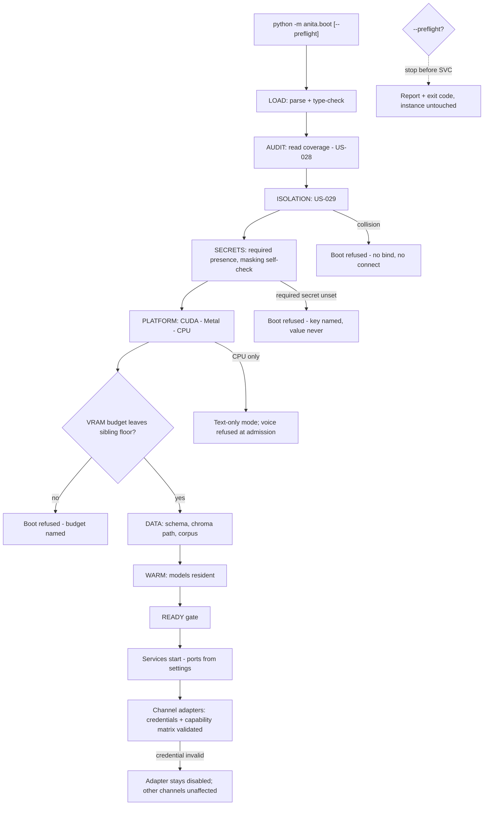

> **Lens:** PO / TPO (technical ACs) / Architect (HLD, LLD) · **Engagement:** Brownfield

# US-030 — Platform detection, secret policy and a preflight that never touches the live instance [Lens: PO]

- **Story:** As an **ops admin**, I want **one configuration to start correctly on the Windows/NVIDIA box and on the Apple Silicon machine, secrets that are never printed, and a preflight command that validates a configuration change without disturbing the running service**, so that **I can change a setting at 02:00 and know it is good before I restart, instead of discovering a bad value by taking the product down**.
- **Business value:** `BRD-19` and `BRD-18`. Two deployment machines with different accelerators is a stated constraint, and the source repository ships live credentials in `.env.bak-*` files — a configuration story that copies an environment file is a security incident waiting to happen (`REC-21`). The preflight is what makes US-028's and US-029's hard refusals tolerable operationally.
- **Priority:** **Must** — TPO ordering note: it is the last MOD-09 story; it consumes the settings (US-028) and the isolation report (US-029) and completes the boot sequence. It must land before the channel adapters so that every channel's credentials and capabilities are validated at boot rather than discovered at first traffic.

## Acceptance Criteria [Lens: PO]

```gherkin
Scenario: Boot on the Windows machine
  Given a machine with an NVIDIA GPU
  When the instance starts
  Then the platform is detected as CUDA without any hand-set provider
  And the Ollama backend and CUDA STT are selected
  And the VRAM budget is asserted against the shared card

Scenario: Boot on the Apple Silicon machine
  Given a machine with Apple Metal and no NVIDIA GPU
  When the instance starts
  Then the platform is detected as Metal and the MLX backend is selected
  And the same configuration file is used, unchanged

Scenario: Boot with no accelerator
  Given a machine with neither CUDA nor Metal
  When the instance starts
  Then the platform is detected as CPU
  And the instance boots in text-only mode
  And voice calls are refused at admission with a busy message rather than served at unusable latency

Scenario: A required secret is missing
  Given ANITA_ADMIN_TOKEN is not set anywhere
  When the preflight runs
  Then it fails naming the key
  And it reports only "unset", never a value

Scenario: A secret would be logged
  Given a log line or config render that would contain a secret value
  When the boot self-check runs
  Then the boot fails hard
  And the failing line is identified by key, not by value

Scenario: A configuration change is validated before restart
  Given a running instance serving traffic
  When the operator runs the preflight with a broken configuration
  Then the preflight fails with the specific reason
  And the running instance is untouched and keeps serving

Scenario: The GPU budget would starve the other product
  Given a budget that leaves the sibling below its floor
  When the preflight runs
  Then it fails naming the budget and the sibling floor
```

Technical acceptance criteria [Lens: TPO]:

- **TAC-1:** The platform branch is **derived, never hand-set**: `detect_platform()` probes CUDA → Metal → CPU in order, and `pick_model()` maps the result to a backend. No config file differs between operating systems except paths, and an operator never edits an OS-specific value to make the stack start (`M9-5`).
- **TAC-2:** Secrets are read only from the process environment or an `ANITA_*`-prefixed file; the source repository's `.env`, `.env.bak-*` files are `forbidden` — never read, never copied — and the migration carries **key names only** into a fresh `.env.example` (`REC-21`).
- **TAC-3:** Any key matching `TOKEN|SECRET|PASSWORD|PASSWD|KEY|CREDENTIAL|SID|AUTH` is masked in every render, log line, audit entry and error message; only `set`/`unset` is reported (`M9-4`, `AC-M9-7`). A startup self-check greps the rendered config and the first **200** log lines for secret values and fails hard on a hit.
- **TAC-4:** The preflight (`python -m anita.boot --preflight`) runs the ordered phases to completion **without starting any service, binding any port or opening any DB connection**; it is idempotent, side-effect-free, and safe to run against a live instance (`TRD-44` #3).
- **TAC-5:** Preflight completes ≤ **20 s** excluding model warm-up (Assumed); the `READY` gate is not satisfied until every required service answers its health check within **30 s** (Assumed); boot attempts before an operator alert: **3**.
- **TAC-6:** The VRAM budget is computed against the **shared** 16,311 MiB card: an ANITA budget that would leave the sibling product below its floor (Assumed: 6,144 MiB) is a boot refusal, not a warning (`AS-09`, `CV-01`).
- **TAC-7:** Every logger writes under `ANITA_LOG_DIR`; no handler may target the repository-root `logs/` or any sibling path (`TRD-44` #2).

## HLD — Architecture Slice [Lens: Architect]



- **Components touched:**
  - `MOD-09 PlatformDetector` — new: CUDA/Metal/CPU probe and backend mapping (`REC-19` reuse of `app/platform.py`, `app/hardware_profile.py`, `app/memory_budget.py`).
  - `MOD-09 SecretPolicy` — new: masking, required-presence checks, the log self-check, the `.env` prohibition (`REC-21`).
  - `MOD-09 Preflight` — new: the ordered phase runner, shared by boot and by `--preflight` (`REC-18` reuse of the source's multi-phase orchestration, minus hard-coded ports and the Step 4b clone).
  - `MOD-09 ReadinessGate` — new: health-check aggregation and the `READY` state (`REC-19` reuse of `app/boot_readiness.py`).
  - `MOD-01 ChannelAdapters` — existing: consumes the capability matrix the preflight validated; enabling/disabling per channel is that module's contract.
  - `MOD-03/MOD-04` — existing: models warmed through their loaders; the preflight warms only when `--warm` is passed.
  - `MOD-08 read API` — existing: reports platform, budget, phase timings and channel capability states.
- **Interaction summary:**
  1. The preflight runs the ordered phases; each phase has a hard failure that stops the sequence (`TRD-44` #3).
  2. `SECRETS` checks required presence and runs the masking self-check; a leak aborts the boot.
  3. `PLATFORM` derives the device and backend, then asserts the VRAM budget against the shared card and the sibling's floor.
  4. `DATA` verifies the schema is present-or-creatable, the Chroma path is writable and the corpus passes the `REC-23` validation gate.
  5. `WARM` loads models (skipped in `--preflight` unless `--warm`); the `READY` gate aggregates health checks.
  6. **Failure path:** any refusal leaves the live instance running and untouched — the preflight is a separate process that never binds a port and never connects to the database.

## LLD — Implementation Detail [Lens: Architect]

- **Classes / functions / APIs:**

```python
# app/anita/platform/detect.py   (REC-19: app/platform.py + app/hardware_profile.py)
@dataclass(frozen=True)
class DeviceConfig:
    device: Literal["cuda", "metal", "cpu"]
    compute_type: str                  # "float16" | "int8" | "int8"
    dtype: str
    total_memory_mib: int | None       # None on CPU
    reason: str                        # why this branch won — always populated

def detect_platform() -> DeviceConfig: ...     # CUDA -> Metal -> CPU (TAC-1)
def pick_model(device: DeviceConfig, settings: AnitaSettings) -> ModelConfig: ...
    # windows/linux + cuda -> Ollama (OLLAMA_MODEL, OLLAMA_KEEP_ALIVE)
    # macos + metal       -> MLX (MLX_BASE_URL on MLX_PORT, MLX_MODEL)
    # cpu                 -> Ollama + smaller model; voice admission OFF

# app/anita/platform/budget.py   (REC-19: app/memory_budget.py)
SHARED_GPU_MIB = 16_311                 # the one card, shared with the sibling product
SIBLING_FLOOR_MIB = 6_144               # Assumed
def vram_budget(device: DeviceConfig, *, models_mib: int,
                shared_total_mib: int = SHARED_GPU_MIB,
                sibling_floor_mib: int = SIBLING_FLOOR_MIB) -> Budget: ...
    # raises BudgetWouldStarveSibling when anita_share > shared - floor

# app/anita/config/secrets.py   (REC-14 masking pattern, REC-21 policy)
SECRET_MARKERS = re.compile(r"TOKEN|SECRET|PASSWORD|PASSWD|PASS|KEY|CREDENTIAL|SID|AUTH")
FORBIDDEN_SECRET_FILES = (".env",)      # plus any .env.bak-* (REC-21)

class SecretPolicy:
    def required(self) -> tuple[str, ...]: ...          # ("ANITA_ADMIN_TOKEN", "TWILIO_AUTH_TOKEN")
    def check_presence(self) -> dict[str, Literal["set", "unset"]]: ...
    def render_masked(self, settings: AnitaSettings) -> dict[str, str]: ...
    def assert_no_leak(self, lines: Sequence[str]) -> None: ...   # raises SecretLeakDetected
    def assert_no_forbidden_read(self, opened_paths: Sequence[Path]) -> None: ...
        # raises ForbiddenSecretFile if any opened path is a .env-family file (TAC-2)

# app/anita/boot/preflight.py   (REC-18: bootstrap orchestration, ports from settings)
Phase = Literal["LOAD", "AUDIT", "ISOLATION", "SECRETS", "PLATFORM", "DATA", "WARM"]

@dataclass(frozen=True)
class PhaseResult:
    phase: Phase; ok: bool; ms: int; reason: str = ""

class Preflight:
    def __init__(self, *, preflight: bool = True, warm: bool = False) -> None: ...
    def run(self) -> tuple[PhaseResult, ...]: ...       # stops at the first failure (TAC-4)
    def channel_capabilities(self) -> dict[str, dict[str, bool]]: ...
        # validated at boot; enabling an adapter is MOD-01's contract

def readiness_gate(services: Sequence[HealthCheck], timeout_s: int = 30) -> bool: ...
def main(argv: list[str]) -> int: ...   # --preflight --warm --json; exit non-zero on any refusal
```

- **Data schema changes:** none in Postgres — the preflight runs before any connection exists. It appends one JSONL line per boot to `ANITA_LOG_DIR/boot_audit.jsonl` (the `US-028` shape, extended with phase timings and the channel capability states); the write is best-effort and is skipped entirely in `--preflight` when the log directory is unwritable.

```json
{"event":"preflight","mode":"preflight","at":"2026-10-03T09:12:04Z",
 "phases":[{"phase":"LOAD","ok":true,"ms":41},{"phase":"AUDIT","ok":true,"ms":188},
           {"phase":"ISOLATION","ok":true,"ms":12},{"phase":"SECRETS","ok":true,"ms":3},
           {"phase":"PLATFORM","ok":true,"ms":1204,"device":"cuda","total_memory_mib":16311},
           {"phase":"DATA","ok":true,"ms":220},{"phase":"WARM","ok":false,"ms":0,"reason":"skipped (no --warm)"}],
 "budget":{"anita_mib":9800,"sibling_floor_mib":6144,"shared_total_mib":16311},
 "channels":{"web":{"text":true,"media":false,"voice":true},"whatsapp":{"text":true,"media":true,"voice":false}},
 "secrets":{"ANITA_ADMIN_TOKEN":"set","TWILIO_AUTH_TOKEN":"set"},
 "result":"ok"}
```

- **Edge cases** (each with the decided behaviour):
  1. **CUDA present but the driver/`nvidia-smi` probe fails** → fall through to CPU with `reason` naming the probe failure; never a crash, never a silent half-detected CUDA (`TAC-1`).
  2. **Metal available but MLX is not installed** → CPU with a clear reason; voice is refused at admission on that boot.
  3. **Device changes between detection and model load (eGPU removed, driver reset)** → warm-up fails; the `READY` gate is not satisfied, an alert is raised, and the instance does not serve a half-warmed stack.
  4. **CUDA detected on macOS (impossible in practice, guarded anyway)** → the macOS branch wins on OS, and the reason records the contradiction rather than trusting one probe.
  5. **VRAM budget exactly equals `shared_total - sibling_floor`** → allowed (equality is not starvation); one MiB over → refusal naming both numbers (`TAC-6`).
  6. **CPU-only boot** → text-only: the capability matrix marks voice `false` for every channel, and an inbound voice call is refused at admission with a busy message rather than served (`BRD-19`, `06-architecture.md` §5).
  7. **Required secret set to an empty string** → `unset`; a required secret is never satisfied by emptiness (`M9-4`).
  8. **Secret value wrapped in quotes or with trailing whitespace** → trimmed once at load; the trimmed value is what is masked and what is used, so a quoting artefact cannot produce a `401` nobody can explain.
  9. **A non-secret key containing a marker (`ANITA_MONKEY_COUNT`)** → masked by the marker rule; documented as an accepted false-positive class, and the key is renamed at review time rather than special-cased (`REC-14`'s masking property preserved).
  10. **A `.env` file present in the working directory** → `assert_no_forbidden_read` fails the boot: the file is not read, and its mere presence on the read path is an error (`REC-21`).
  11. **Preflight run while the live instance is serving** → passes or fails without binding, connecting, or writing anything the live instance reads; the live instance is untouched (`TAC-4`).
  12. **Channel declaration with unknown capability (`"hologram": true`)** → `DATA` phase refuses with the channel and the offending capability.
  13. **Channel with no capability declaration** → defaults to text-only and a warning; this is the `UC-14` missing-data behaviour, validatable at boot and applied when the adapter is enabled.
  14. **Channel credential present but the webhook secret missing** → inbound-capable only, warning; the outbound half is not marked healthy (`UC-14` partial-data row).
  15. **Corpus absent or not the ANITA catalogue** → `DATA` refuses (the `REC-23` validation-gate pattern), because the wrong corpus is the failure the gate exists to prevent.
  16. **Chroma path unwritable** → `DATA` refuses; the path is named.
  17. **Preflight exceeds 20 s** → it is not killed mid-phase; it completes and reports its overrun, and the overrun is alerted. A preflight timeout that truncated phases would produce a false pass.
  18. **Three failed boot attempts** → an operator alert is raised; the refusal text is identical each time so the operator's fix is never chased by a changing message.

- **Error handling:**
  - `BootRefused(phase, reason)` — the single failure type for every phase; exit code non-zero; `--json` emits the phase list.
  - `SecretLeakDetected(key)` / `ForbiddenSecretFile(path)` — security refusals; the value is never printed, the key or path is (`TAC-3`, `TAC-2`).
  - `BudgetWouldStarveSibling(anita_mib, sibling_floor_mib, shared_total_mib)` — refusal with all three numbers (`TAC-6`).
  - `PlatformProbeFailed(probed, reason)` — swallowed into `DeviceConfig.reason` and the CPU fallback; not a refusal by itself.
  - `WarmupIncomplete(service)` — `READY` not satisfied; alert; no serving of a half-warm stack.

- **Test scenarios** (floor = every `✓` row of the `UC-14` Scenario Coverage table, at the boot-time validation layer this story owns; the runtime enable/disable behaviour belongs to the MOD-01 adapter story, and the model-residency display rows of `UC-12` are exercised here too):
  - *Unit* — happy path: a stubbed CUDA host → `detect_platform().device == "cuda"`, Ollama backend, `compute_type` set, `reason` populated.
  - *Unit* — happy path (Mac): a stubbed Metal host → `metal`, MLX backend, the same settings object, no OS-specific config edit (`TAC-1`).
  - *Unit* — alternate A1 (send-only channel): a channel declared without an inbound webhook → capability matrix marks inbound `false`, outbound `true`, no inbound route validated; boot passes.
  - *Unit* — invalid input: a channel capability key outside the known set → `DATA` refusal naming the channel and the capability (`UC-14` invalid-input row).
  - *Unit* — unauthorized user: the preflight is an ops-run process; the console's platform/budget view is admin-only (`DG-06`, CV-03).
  - *Unit* — missing data: a channel with no capability declaration → text-only with a warning (`UC-14` missing-data row).
  - *Unit* — partial data: credential present, webhook secret missing → inbound-only, warning, channel not marked healthy (`UC-14` partial-data row).
  - *Unit* — duplicate request: the preflight run twice → identical phase results; the enable path for an existing channel is a no-op (`UC-14` duplicate row).
  - *Unit* — timeout: a stubbed provider handshake that exceeds the budget → `DATA` refuses with the provider named; no adapter is enabled (`UC-14` timeout row, E1).
  - *Unit* — dependency failure: a stubbed unreachable provider → that channel is marked disabled while every other channel's capabilities validate unaffected (`UC-14` dependency row).
  - *Unit* — retry: the same preflight after the provider is restored → passes; nothing was mutated by the failed attempt (`UC-14` retry row).
  - *Unit* — concurrent operation: two preflights in parallel → both complete; a second enable of the same channel is a no-op (`UC-14` concurrent row).
  - *Unit* — cancellation: a channel marked disabled → inbound for it is refused politely by the adapter, its configuration is retained, and the boot is unaffected (`UC-14` cancellation row).
  - *Unit* — recovery: re-enabling after a credential fix restores the channel without a restart of the other channels (`UC-14` recovery row).
  - *Unit* — partial completion: inbound declared live while outbound fails its check → the channel is reported `degraded`, never healthy (`UC-14` partial-completion row).
  - *Unit* — secrets: `render_masked()` masquerades every marked key; `check_presence()` reports only `set`/`unset`; a required key unset refuses (`TAC-3`).
  - *Unit* — leak detection: a fabricated log line containing a secret value → `SecretLeakDetected` naming the key; the value appears nowhere in the assertion output (`AC-M9-7`).
  - *Unit* — forbidden file: a `.env` file in the read path → `ForbiddenSecretFile`; `.env.bak-2026` also refuses (`REC-21`).
  - *Unit* — budget: `anita_mib = 16311 - 6144` passes; one MiB more refuses with all three numbers (`TAC-6`).
  - *Unit* — platform fallback: a probe that raises → CPU with the reason recorded; no exception escapes.
  - *Integration* — preflight ordering: with a forced `AUDIT` failure, `ISOLATION`/`SECRETS`/`PLATFORM`/`DATA` do not run; the phase list shows where it stopped (`TRD-44` #3).
  - *Integration* — side-effect freedom (`TAC-4`): a preflight against a live instance → a socket spy sees zero binds, a DB spy zero connections, and the live instance's request latency is unchanged.
  - *Integration* — live-instance safety: a broken config preflight while serving → non-zero exit, the live instance answers a health check throughout.
  - *Integration* — log isolation: every log handler's target resolves under `ANITA_LOG_DIR`; a handler pointed at the repository-root `logs/` fails a test (`TAC-7`).
  - *E2E* — Windows/NVIDIA host: `--preflight --warm` → CUDA, Ollama, budget within the sibling floor, `READY` gate true, services start on 8100/8601/8602 from settings (no literals).
  - *E2E* — Apple Silicon host: the same repository and configuration → Metal, MLX, `READY` gate true, with no file change between the two hosts other than paths.
  - *E2E* — CPU-only host: boot succeeds text-only, a voice call is refused at admission with the busy message, and the console reports voice `false` in the capability matrix.
  - *Load* — 50 preflights on the target hardware → p95 ≤ 20 s excluding warm-up; p95 phase breakdown within the `TRD-44` budget (TAC-5).

## Traceability
- Parent module: `MOD-09`
- Use case: `UC-14` (boot-time validation of channel credentials and the capability matrix; the runtime enable path is MOD-01's), `UC-12` (platform, budget and model-residency reporting) · technical requirements: `TRD-43`, `TRD-44`
- Business requirement: `BRD-19`, `BRD-18`
- Constraint / state: `CV-01` (the GPU is shared; the Twilio account is shared), `AS-09`, `M9-4`, `M9-5`, `M9-6`, `M9-7`
- Reconciliation: `REC-19` (`reuse` — `app/platform.py`, `app/hardware_profile.py`, `app/memory_budget.py`, `app/boot_readiness.py`), `REC-18` (`refactor` — the multi-phase orchestration survives, hard-coded ports and the Step 4b clone removed), `REC-21` (`forbidden` — no `.env*` file is read or copied; key names only), `REC-08` (model backend selection), `REC-23` (the corpus gate in the `DATA` phase)
- Data asset: `DAT-13` (configuration: secrets presence, platform, capability matrix)

## Definition of Done
- [ ] All ACs pass (AC-1 … AC-7, TAC-1 … TAC-7)
- [ ] Tests from the LLD test scenarios pass, including the leak-detection, forbidden-file, budget-boundary and zero-side-effect preflight assertions
- [ ] Load test passed: preflight p95 ≤ 20 s excluding warm-up (TAC-5)
- [ ] No schema migration (by design — preflight precedes any connection)
- [ ] Verified on both target machines with no configuration difference other than paths; CPU-only fallback verified on a third
- [ ] A grep of the repository finds no `.env`-family file copied from the source and no secret value committed
- [ ] Module docs updated if the phase order or capability matrix shape changed
